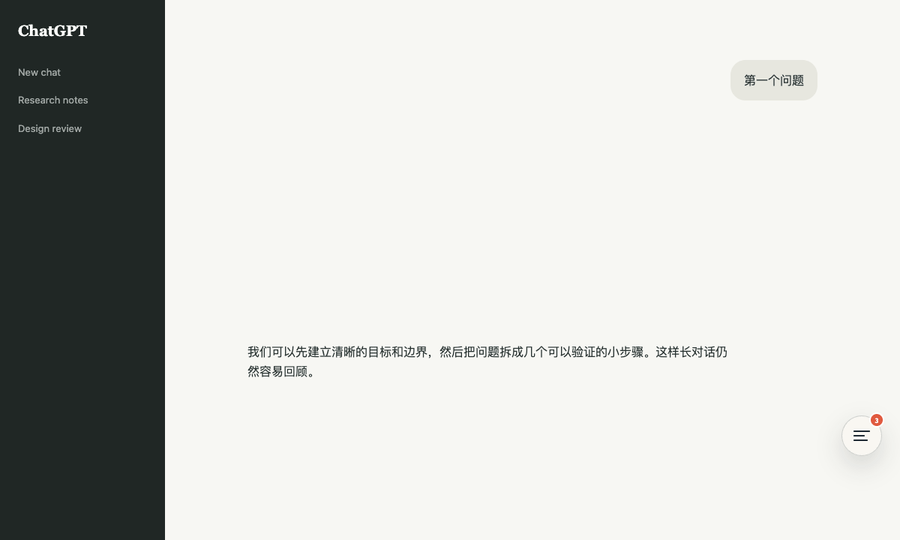

# ChatGPT ThreadMap

English | [简体中文](README.md)

> Turn long ChatGPT conversations into a searchable, navigable map.



ChatGPT ThreadMap is a lightweight browser extension for navigating long conversations on `chatgpt.com`. It indexes your prompts in real time, follows your reading position, and jumps directly to the selected message. All processing happens locally inside the current page.

## Features

- **Live conversation map:** New prompts appear automatically.
- **Accurate navigation:** Targets the visible user-message bubble instead of an unstable wrapper.
- **Current-position tracking:** The active entry follows your reading position.
- **Instant filtering:** Find a prompt by typing any part of its text.
- **Unobtrusive interface:** A compact lower-right button keeps ChatGPT's sidebars untouched.
- **Keyboard access:** Press `Alt + J` to open or close the map.
- **Privacy-friendly:** No backend, analytics, storage permission, or network permission.

## Installation

### Recommended: install the minimal Release package

1. Open [Releases](https://github.com/Relax-boy/chatgpt-threadmap/releases) and download the latest `ChatGPT-ThreadMap-*.zip`.
2. Extract the downloaded archive.
3. Open `chrome://extensions` in Chrome or `edge://extensions` in Edge.
4. Enable **Developer mode**.
5. Select **Load unpacked** and choose the extracted folder.
6. Refresh any open `chatgpt.com` tab.

Disable other conversation-navigation extensions first to avoid duplicate controls.

## Usage

1. Open a conversation on `chatgpt.com`.
2. Select the ThreadMap button near the lower-right corner.
3. Choose a prompt from the list, or type a keyword to filter it first.
4. The page jumps to that user message. As you continue scrolling, the active entry follows your position.

## Minimal extension package

The ZIP attached to each Release contains only the files required by the browser:

```text
manifest.json
assets/
├── icon-16.png
├── icon-32.png
├── icon-48.png
└── icon-128.png
src/content/
├── navigator.js
└── navigator.css
```

The bilingual documentation, demo GIF, and license stay in the source repository and are excluded from the installation package.

## Source repository structure

```text
chatgpt-threadmap/
├── assets/                 extension icons and demo GIF
├── src/content/            extension runtime code
├── manifest.json           Manifest V3 configuration
├── README.md               Chinese documentation
├── README_EN.md            English documentation
└── LICENSE                 MIT license
```

## Privacy

ThreadMap reads message elements only inside the current ChatGPT tab to build the local map. It does not upload, persist, or analyze your conversations outside that page. The manifest requests no optional permissions.

## Compatibility

- Manifest V3
- Google Chrome and Microsoft Edge
- `https://chatgpt.com/*`

ChatGPT's page structure changes over time. If indexing or navigation stops working, open an Issue with your browser version and a sanitized DOM sample. Never include private conversation text.

## License

[MIT](LICENSE)
